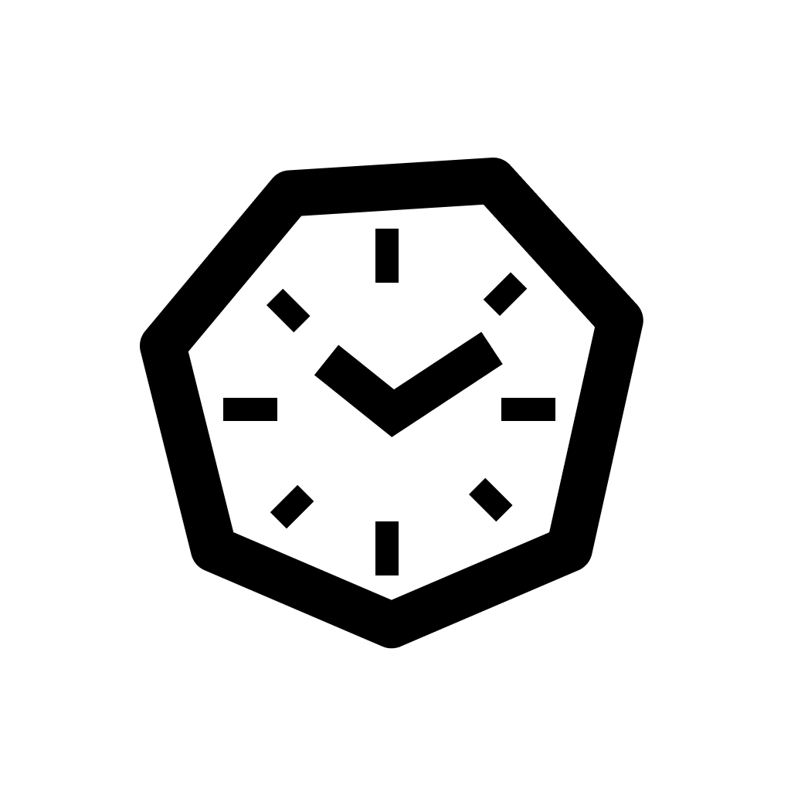
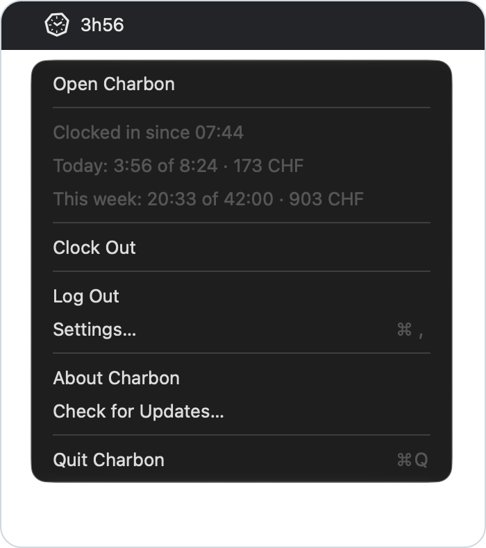
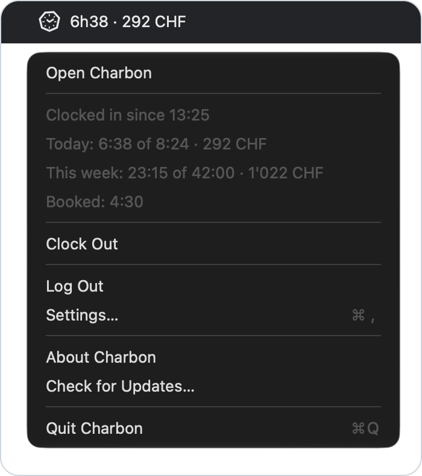
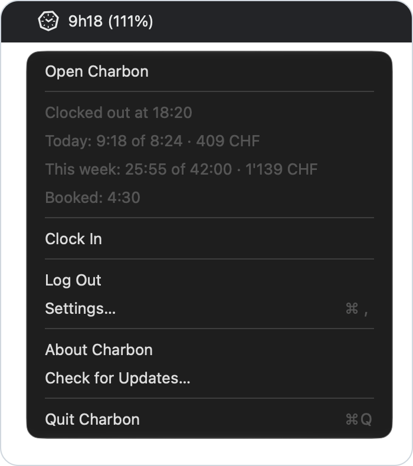
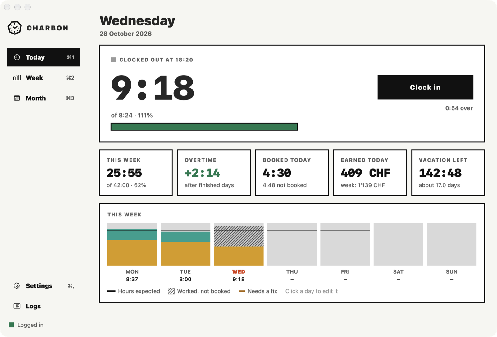
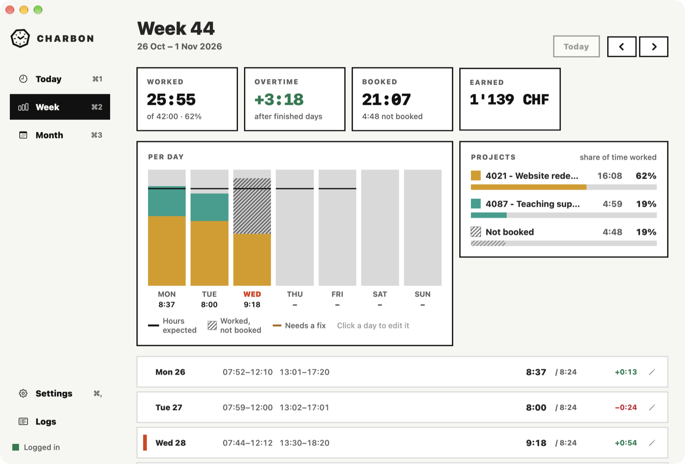
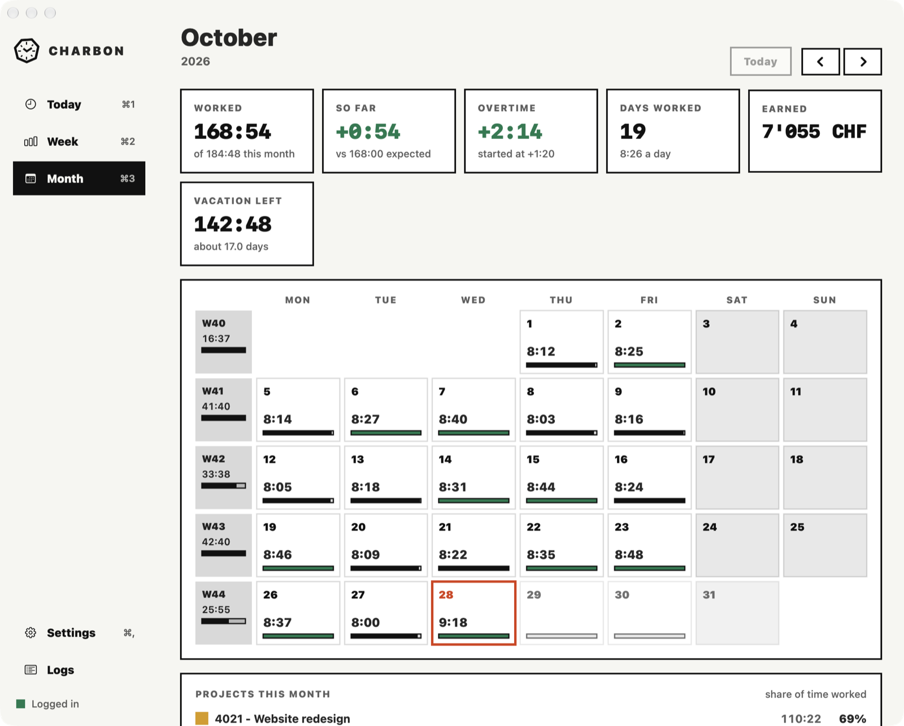

<p align="center">
  
</p>

<h1 align="center">Charbon</h1>

<p align="center">
  Clock in and out and book your hours on timbrage.hefr.ch<br>
  from the menu bar of your Mac. It renews your session in the background so you rarely see the login page.
</p>

<p align="center">
  <a href="https://github.com/elwan-l1/charbon/releases/latest">Download</a> ·
  <a href="#install">Install</a> ·
  <a href="#always-in-the-menu-bar">Features</a> ·
  <a href="#private-by-default">Privacy</a> ·
  <a href="CHANGELOG.md">Changelog</a>
</p>

<p align="center">
  <a href="https://github.com/elwan-l1/charbon/releases"></a>
  <a href="https://github.com/elwan-l1/charbon/releases"></a>
  <a href="https://github.com/elwan-l1/charbon/actions/workflows/ci.yml"></a>
  <a href="#what-you-need"></a>
  <a href="#build-it-yourself"></a>
</p>

<p align="center">
  
  
  
</p>

Timbrage logs you out all the time and makes you click through four pages to log in again. Charbon sits in the menu bar and renews your session before it dies. Clocking in is one click or none: it can stamp by itself when you open and close your Mac.

It is a small native app. No account, no server of its own and no telemetry.

> Charbon is an independent project. It is not made or supported by HES-SO or the Timbrage team.

## Always in the menu bar

Put what you care about next to the icon. Pick one of seven formats: just the icon, time worked, time worked and share of the day, the share alone, time worked and earnings, the earnings alone or the time left today. It refreshes every 30 seconds.

What you see when you click on it:

- Whether you are clocked in or out and since when.
- Today: the time worked out of your target, with what you earned.
- This week: the same.
- The hours already booked.
- Clock In or Clock Out.
- Open Charbon, Settings, Check for Updates and Quit.

## Stay logged in

Charbon renews the session when it starts, when the Mac wakes up and about every 90 minutes. When edu-ID still remembers you this is silent and you never see a login page. When it forgot you, you log in by hand.

When something fails you get a short sentence and a code like `1001`, never a stack trace.

### Automatic login (optional, not recommended)

To stay connected all the time you can turn on automatic login in Settings. Charbon then fills the edu-ID pages itself with your email, your password and your authenticator key whenever edu-ID forgets you. It takes about three seconds.

> **Think twice before you turn it on.** It keeps your password and your authenticator key side by side on the same Mac. A one-time code is only a second factor when it lives on another device. With the key here anyone who can open your Keychain gets both. Without automatic login Charbon still renews your session and you only log in by hand when edu-ID asks.

If you still want it:

- The login goes to the Keychain of your Mac and nowhere else.
- A wrong password never locks your account. After two failed tries the automatic login pauses until you save the login again.
- **Log out** in Settings forgets the saved login.

## Clock in and out

- Clock in and out from the window or the menu bar.
- Clocking out books your hours on your default project.
- **Automatic clock:** clocks you in when you open your Mac and out when you close it. You choose the time windows.
- Fix any stamp or booking by hand.

## Today, week and month

Hours worked, overtime, earnings and what is not booked yet.

<p align="center">
  <picture>
    <source media="(prefers-color-scheme: dark)" srcset="docs/assets/readme/today-dark.png">
    
  </picture>
</p>

<p align="center">
  <picture>
    <source media="(prefers-color-scheme: dark)" srcset="docs/assets/readme/week-dark.png">
    
  </picture>
  <picture>
    <source media="(prefers-color-scheme: dark)" srcset="docs/assets/readme/month-dark.png">
    
  </picture>
</p>

## Install

1. Download `Charbon-x.y.z.dmg` from the [latest release](https://github.com/elwan-l1/charbon/releases/latest).
2. Double-click the `.dmg` to open it.
3. Drag Charbon into the Applications folder in the window that appears.
4. Open Charbon from Applications and log in to Timbrage once.

Builds are signed with an Apple Developer ID and notarized so macOS opens them without a warning.

### Updates

Charbon never checks for updates on its own. Choose **Check for Updates…** in the menu bar or in the Charbon menu when you want to. Updates are signed and checked before they install.

### Uninstall

Choose **Log out** in Settings to remove the cookies and the saved login. Then move Charbon to the Trash. To remove everything else:

```sh
defaults delete ch.codevs.charbon
rm -rf ~/Library/Application\ Support/Charbon
```

## Private by default

Charbon only talks to two places:

- `timbrage.hefr.ch` and the Switch edu-ID login pages to keep your session and to read and write your hours.
- GitHub only when you choose **Check for Updates…**.

Everything else stays on your Mac:

- Your session cookies and the optional saved login live in the macOS Keychain.
- Your settings and your pay stay in the preferences of the app.
- The logs stay in `~/Library/Application Support/Charbon` and hold names, codes and times only.

There is no analytics, no tracking and no server of ours.

## What you need

- A Mac with macOS 14 Sonoma or newer
- An HES-SO account for [timbrage.hefr.ch](https://timbrage.hefr.ch)

## Build it yourself

```sh
git clone https://github.com/elwan-l1/charbon.git
cd charbon
make bootstrap   # install the tools and generate the Xcode project
make run         # build and launch the app
make verify      # lint and run all the tests
```

Xcode and [Homebrew](https://brew.sh) are the only requirements. The Xcode project comes from `project.yml` so edit that and run `make generate` instead of editing the project file.

## Documentation

- [How the Timbrage server works](docs/API.md): the calls Charbon makes and the traps.
- [AGENTS.md](AGENTS.md): the architecture, the session flow and the rules of the code.
- [Changelog](CHANGELOG.md): what changed in each version.
